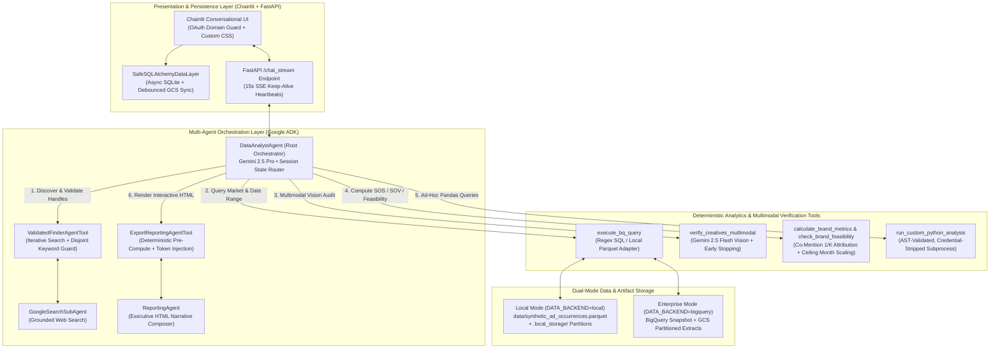

# Autonomous Brand Analytics & Multimodal Creative Verification Agent

[](https://www.python.org/)
[](https://google.github.io/adk-docs/)
[](https://deepmind.google/technologies/gemini/)
[](#dual-backend-execution-local-vs-bigquery)
[](#7-verification--testing)
[](./LICENSE)

An enterprise-grade, multi-agent conversational marketing intelligence platform built with **Google Agent Development Kit (ADK)**, **Gemini 2.5 Pro & Flash**, **FastAPI**, **Chainlit**, **BigQuery / PyArrow Parquet**, and **Plotly**.

This system automates the end-to-end competitive advertising intelligence workflow across **49 global markets**:
1. **Iterative Brand Identity & Handle Discovery** via grounded web search with programmatic disjoint-keyword validation.
2. **Parameterized Multi-Market SQL Extraction** over digital advertising occurrence datasets with incremental partitioned caching and hash-based deduplication.
3. **Multimodal Vision Creative Verification** using **Gemini 2.5 Flash** with domain pre-filtering, video/image batch splitting, and **mathematical early stopping** to eliminate redundant LLM calls.
4. **Deterministic Executive HTML Report Generation** combining narrative synthesis with pre-rendered interactive **Plotly** dashboards and an AST-validated, credential-stripped Python sandbox.

---

## Table of Contents
1. [Business Problem & Engineering Motivation](#1-business-problem--engineering-motivation)
2. [System Architecture](#2-system-architecture)
3. [Seven Core AI Engineering Patterns](#3-seven-core-ai-engineering-patterns)
4. [Interactive Sample Reports & Synthetic Dataset](#4-interactive-sample-reports--synthetic-dataset)
5. [Repository Structure](#5-repository-structure)
6. [Quickstart Guide (Zero-Cloud Local Mode & Enterprise GCP Mode)](#6-quickstart-guide)
7. [Verification & Testing](#7-verification--testing)

---

## 1. Business Problem & Engineering Motivation

Competitive digital advertising databases (tracking display, social, video, and search ad occurrences) contain millions of noisy records where brand keywords appear in third-party resellers, podcast/playlist hosts (e.g., Spotify or YouTube player embeds), co-op retail banners, or unrelated brand collisions (e.g., *Lotus Cars* vs. *Lotus Bakeries*).

Traditional BI dashboards fail in three critical ways:
- **Entity Ambiguity & Handle Drift:** Analysts manually maintain brittle lists of advertiser domains and social handles across dozens of local markets.
- **Unverified Spend & Impression Inflation:** Keyword matches alone cannot distinguish whether an ad creative genuinely promotes a target brand within a specific product category (e.g., *Christian Dior Couture* vs. *Dior Beauty* vs. counterfeit perfume resellers), inflating Share of Spend (SOS) and Share of Voice (SOV).
- **LLM Hallucination & Cost Explosion:** Naive LLM agents either hallucinate numbers when writing long HTML reports or rack up massive vision API bills by passing thousands of ad creatives through multimodal models when a brand has already met—or mathematically cannot meet—campaign feasibility thresholds.

This repository demonstrates how to solve these production challenges using **hierarchical tool-wrapped sub-agents, deterministic data handles, mathematical early stopping, and hybrid code/token report injection**.

---

## 2. System Architecture



---

## 3. Seven Core AI Engineering Patterns

### 3.1 Dual-Backend Execution (`DATA_BACKEND=local | bigquery`)
To allow anyone to clone, test, and evaluate the full agent pipeline without Google Cloud credentials or proprietary datasets, [`brand_analytics_app/tools/bq_query.py`](./brand_analytics_app/tools/bq_query.py) implements a clean storage abstraction controlled by `DATA_BACKEND`:
- **`DATA_BACKEND=local` (Default for Local Demo):** Reads from [`data/synthetic_ad_occurrences.parquet`](./data/synthetic_ad_occurrences.parquet) (15,488 realistic ad occurrence records across 5 countries and 3 industries), applies the exact same regex word-boundary matching (`\bkeyword\b`), country filtering, and date slicing in-memory, and writes partitioned Parquet extracts to `.local_storage/`.
- **`DATA_BACKEND=bigquery` (Enterprise Production):** Executes dry-run cost estimation (`BQ_MAX_BYTES_BILLED` circuit breaker), runs parameterized `REGEXP_CONTAINS` queries against BigQuery, and streams partitioned Parquet extracts to Google Cloud Storage (`gs://...`).

### 3.2 Self-Validating Sub-Agent Wrapper (`ValidatedFinderAgentTool`)
Standard LLM search agents frequently assign overlapping generic keywords (e.g., `"luxury"` or `"car"`) or substring-colliding handles to competing brands, corrupting downstream attribution.
- [`ValidatedFinderAgentTool`](./brand_analytics_app/agent.py) wraps the search sub-agent and intercepts its JSON output via [`validate_and_clean_keywords()`](./brand_analytics_app/tools/utils.py).
- It enforces lowercase normalization, strips leading `@` symbols, and checks all brand pairs $(B_i, B_j)$ for **exact overlap** ($k_a = k_b$) or **substring containment** ($k_a \subset k_b$).
- If a collision is detected, the tool does **not** fail to the user; instead, it automatically re-prompts the sub-agent up to `max_retries=2` with the exact offending keywords so the agent self-corrects before returning the `BrandIdentityOutput` schema.

### 3.3 State-Retaining Partitioned Extracts & Hash Deduplication
Rather than passing thousands of database rows through the LLM context window, [`execute_bq_query`](./brand_analytics_app/tools/bq_query.py) returns lightweight URI handles (`gcs_uri` or `file://`) partitioned by market and date window:
```text
{storage_root}/{app_name}/{user_id}/{session_id}/tmp_bq_extracts/
└── country={country}/
    └── date_range={start_date}_{end_date}/
        └── extract_{timestamp}.parquet
```
When a user expands their analysis mid-conversation (e.g., *"Now add April 2026 and include Audi"*), [`_load_query_results()`](./brand_analytics_app/tools/data_loader.py) automatically traverses all session partitions and deduplicates overlapping date ranges using a deterministic row hash over hashable columns (excluding partition metadata).

### 3.4 Co-Mention Fractional Attribution & Date-Scaled Feasibility
When a single ad creative mentions $K$ target brands simultaneously (e.g., a dealership comparison banner matching both `bmw` and `mercedes`), naive aggregation double-counts spend and impressions.
- [`calculate_brand_metrics()`](./brand_analytics_app/tools/metrics.py) and [`check_brand_feasibility()`](./brand_analytics_app/tools/feasibility.py) compute a per-row split factor $w_r = \frac{1}{K_r}$, attributing $\text{Spend}_r \cdot w_r$ and $\text{Impressions}_r \cdot w_r$ to each matched brand.
- Feasibility thresholds ($\tau_{\text{spend}}, \tau_{\text{impr}}$) are stored as 12-month annual baselines per country and dynamically scaled to the query window $[t_{\text{start}}, t_{\text{end}}]$ using a ceiling-month scale factor:

$$m = \max\left(1, \left\lceil \frac{(t_{\text{end}} - t_{\text{start}}).\text{days} + 1}{30.0} \right\rceil\right), \quad s = \frac{m}{12.0}$$

$$\text{Feasible}(B, c) \iff \left(\text{Spend}_{B,c} \ge \tau_{\text{spend}}(c) \cdot s\right) \lor \left(\text{Impressions}_{B,c} \ge \tau_{\text{impr}}(c) \cdot s\right)$$

### 3.5 Multimodal Vision Verification with Mathematical Early Stopping
Verifying thousands of ad creatives with a vision LLM is slow and expensive. [`verify_creatives_multimodal()`](./brand_analytics_app/tools/creative_verification.py) implements a 4-stage optimization pipeline:
1. **Impression-Descending Prioritization:** Groups ad occurrences by unique creative URI per `(country, brand)` and sorts descending by impressions, capping at `MAX_CREATIVE_VERIFICATIONS_PER_BRAND` (default `100`).
2. **Conditional Domain Pre-Filtering:** When no specific product `target_category` is requested, creatives served directly from a brand's verified domain (`advertiser_domain` matching `brand_domains_map`) are auto-verified without calling Gemini Vision. When `target_category` is specified (e.g., verifying *Dior Fashion* vs. *Dior Beauty*), domain pre-filtering is bypassed so every creative undergoes visual category classification.
3. **Multimodal Modality Splitting:** Separates `.mp4` video creatives (`batch_size=1` to respect Gemini multimodal video constraints) from static image creatives (`.png`, `.jpg`, `.gif` at `batch_size=5`), bounded by an `asyncio.Semaphore`.
4. **Dual Mathematical Early Stopping:**
   - **Sufficiency Stop:** Before each batch, if accumulated verified spend or impressions already satisfy the scaled threshold ($\sum \text{Spend}_{\text{verified}} \ge \tau_{\text{spend}} \cdot s$ or $\sum \text{Impr}_{\text{verified}} \ge \tau_{\text{impr}} \cdot s$), remaining unverified creatives for that brand are skipped immediately.
   - **Impossibility Stop:** At any point after evaluating prefix $i$, let $R_i$ be the sum of spend/impressions of all remaining unverified creatives in the cap (assuming no further creatives exist beyond the cap). If even 100% pass rate on the remainder cannot reach the threshold:
     $$\text{Acc}_{\text{spend}} + R_{\text{spend}, i} < \tau_{\text{spend}} \cdot s \quad \land \quad \text{Acc}_{\text{impr}} + R_{\text{impr}, i} < \tau_{\text{impr}} \cdot s$$
     verification halts immediately, saving up to 80–95% of multimodal token costs on low-volume brands.

### 3.6 Deterministic Plotly Pre-Rendering & Token Injection
LLMs struggle to emit multi-megabyte HTML files containing raw Plotly JSON without truncating or hallucinating data points. [`ExportReportingAgentTool`](./brand_analytics_app/agent.py) decouples **computation** from **narrative**:
1. Before invoking `ReportingAgent`, the tool deterministically computes market-partitioned metrics (`calculate_report_metrics`) and pre-renders interactive Plotly figures (`<div>` fragments) stored in memory under placeholders (`{{PLOTLY_FIG_0}}`, `{{PLOTLY_FIG_1}}`, etc.).
2. `ReportingAgent` receives only compact summary tables and placeholder tokens, focusing 100% of its output budget on executive insights, layout structure, and competitive commentary.
3. During [`export_report()`](./brand_analytics_app/tools/export.py), the tool substitutes the `{{PLOTLY_FIG_*}}` tokens with the exact pre-rendered Plotly HTML, injects the Plotly.js CDN, and enforces market-specific `<title>` and `<h1>` tags.

### 3.7 AST-Validated Sandbox & Resilient Cloud Run Streaming
- **Credential-Stripped Python Sandbox ([`code_execution.py`](./brand_analytics_app/tools/code_execution.py)):** When the agent writes custom pandas code to answer bespoke analytical questions, the code is parsed via `ast.parse()` to block unsafe imports (`os`, `sys`, `subprocess`, `shutil`, `socket`, `urllib`, `requests`, `http`) and dangerous builtins (`eval`, `exec`, `open`, `__import__`), then executed in an isolated subprocess stripped of all `GOOGLE_*`, `GCS_*`, `AWS_*`, and `OAUTH_*` environment variables.
- **SSE Heartbeat & Non-Blocking State Sync ([`backend/main.py`](./backend/main.py), [`frontend/safe_data_layer.py`](./frontend/safe_data_layer.py)):** Long-running BigQuery + Gemini Vision turns can take 30–90 seconds. The FastAPI `/chat_stream` endpoint multiplexes ADK runner events with a 15-second `{"status": "processing"}` SSE heartbeat to prevent Cloud Run / load-balancer idle disconnects, while `SafeSQLAlchemyDataLayer` persists Chainlit chat history to local SQLite and asynchronously syncs debounced snapshots to GCS.

---

## 4. Interactive Sample Reports & Synthetic Dataset

This repository includes a deterministic synthetic dataset generator ([`scripts/generate_synthetic_ad_data.py`](./scripts/generate_synthetic_ad_data.py)) and pre-generated HTML showcase reports so you can inspect the agent's output immediately without running a server:

| Artifact | Path | Description |
| :--- | :--- | :--- |
| **Synthetic Ad Occurrences Dataset** | [`data/synthetic_ad_occurrences.parquet`](./data/synthetic_ad_occurrences.parquet) | **15,488 ad rows** (Jan–Apr 2026) across **5 markets** (`Germany`, `United Kingdom`, `United States`, `Singapore`, `Vietnam`) and **3 industries** (*Automotive*: BMW, Mercedes-Benz, Audi, Volkswagen; *Luxury & Beauty*: Dior, Chanel, Gucci; *Confectionery*: Ferrero, Lindt). Includes multi-brand co-mentions and third-party counterfeit/reseller ads for verification testing. |
| **Sample Comprehensive Competitive Report** | [`examples/sample_reports/comprehensive_competitive_report_germany_q1_2026.html`](./examples/sample_reports/comprehensive_competitive_report_germany_q1_2026.html) | Full Q1 2026 Germany Automotive report featuring interactive Plotly charts (Share of Spend vs. Impressions, Monthly Velocity Trends, Channel Group Mix, Top Publisher Domains, Top Creatives) and executive commentary. |
| **Sample Feasibility & Vision Audit Report** | [`examples/sample_reports/feasibility_verification_report_germany_q1_2026.html`](./examples/sample_reports/feasibility_verification_report_germany_q1_2026.html) | Multimodal creative verification showcase demonstrating raw vs. verified feasibility status, interactive filter pills (`All`, `Verified Brand`, `Rejected`), client-side CSV export, and per-creative Gemini Vision explanations. |

To regenerate both the synthetic Parquet dataset and the sample HTML reports at any time:
```bash
python scripts/generate_synthetic_ad_data.py
```

---

## 5. Repository Structure

```text
brand-analytics-agent/
├── brand_analytics_app/              # Core Google ADK Agent Application
│   ├── agent.py                      # Root DataAnalystAgent, ValidatedFinderAgentTool, ExportReportingAgentTool
│   ├── configs.py                    # Centralized env config (DATA_BACKEND, thresholds, country whitelist)
│   ├── app_utils/
│   │   ├── deploy.py                 # Vertex AI Agent Engine deployment CLI
│   │   ├── telemetry.py              # GenAI OpenTelemetry + session-correlated PII-safe logging callbacks
│   │   └── typing.py                 # Pydantic request/response schemas & Cloud Trace feedback models
│   └── tools/
│       ├── bq_query.py               # Dual-backend query tool (BigQuery regex SQL + Local Parquet adapter)
│       ├── code_execution.py         # AST-validated, credential-stripped subprocess Python sandbox
│       ├── creative_verification.py  # Gemini 2.5 Flash multimodal verification + mathematical early stopping
│       ├── data_loader.py            # Partitioned Parquet loader, hash deduplicator, verification URI persistence
│       ├── export.py                 # Deterministic Plotly token injector & market-specific HTML exporter
│       ├── feasibility.py            # Date-scaled feasibility checker (raw & verified creative filtering)
│       ├── metrics.py                # 1/K co-mention Share of Spend (SOS) & Share of Voice (SOV) calculator
│       ├── report_metrics.py         # Pre-renderer for Plotly charts & comprehensive report breakdowns
│       └── utils.py                  # Country whitelist validator, disjoint keyword checker, scale factor math
├── backend/
│   ├── Dockerfile                    # Cloud Run production container for FastAPI backend
│   └── main.py                       # FastAPI server (/chat_stream with 15s SSE heartbeats, /reports static mount)
├── frontend/
│   ├── Dockerfile                    # Cloud Run production container for Chainlit UI
│   ├── app.py                        # Chainlit conversational UI, OAuth domain guard, live step streaming
│   └── safe_data_layer.py            # Resilient SQLAlchemy SQLite data layer with debounced GCS backup
├── data/
│   └── synthetic_ad_occurrences.parquet # 15,488-row multi-market synthetic dataset for local execution
├── examples/
│   └── sample_reports/               # Pre-generated interactive HTML reports (Competitive & Feasibility)
├── scripts/
│   └── generate_synthetic_ad_data.py # Deterministic synthetic ad generator & sample report builder
├── deployment/
│   └── terraform/                    # Terraform IaC for Cloud Run, IAM, Artifact Registry, and Telemetry
├── tests/
│   ├── unit/                         # 67 unit tests covering tools, early stopping, local backend, UI & SSE
│   └── integration/                  # 3 integration tests covering in-memory runner & streaming
├── .github/
│   └── workflows/ci.yml              # Automated GitHub Actions test verification suite
├── .env.example                      # Sanitized environment configuration template (defaults to local mode)
├── LICENSE                           # Apache License 2.0
└── pyproject.toml                    # Dependencies, pytest, ruff, and type checking configuration
```

---

## 6. Quickstart Guide

### Mode A: Zero-Cloud Local Demo (`DATA_BACKEND=local`)
Run the analytics tools, synthetic dataset generator, and full unit test suite locally without a GCP project or BigQuery table.

1. **Clone and configure `.env`:**
   ```bash
   cd brand-analytics-agent
   cp .env.example .env
   ```
   By default, `.env.example` sets `DATA_BACKEND=local` and `LOCAL_DEV_WRITE=True`. (To run the live conversational LLM orchestrator in local data mode, add a `GOOGLE_API_KEY` or configure Vertex AI credentials in `.env`.)

2. **Install dependencies (using `uv` or `pip`):**
   ```bash
   uv sync --dev
   ```

3. **Generate or refresh the synthetic dataset & sample reports:**
   ```bash
   uv run python scripts/generate_synthetic_ad_data.py
   ```

4. **Launch the FastAPI Backend + Chainlit UI:**
   ```bash
   # Terminal 1: Start the FastAPI ADK Backend
   uv run uvicorn backend.main:app --host 127.0.0.1 --port 8080

   # Terminal 2: Start the Chainlit Conversational UI
   uv run chainlit run frontend/app.py --port 8000
   ```
   Open **[http://localhost:8000](http://localhost:8000)** and try:
   > *"Compare automotive brands BMW, Mercedes-Benz, and Audi in Germany and United Kingdom for 2026-01-01 to 2026-03-31, check their campaign feasibility, and export a Comprehensive Competitive report."*

---

### Mode B: Enterprise GCP BigQuery + Cloud Run Deployment (`DATA_BACKEND=bigquery`)
For production deployment connected to live BigQuery advertising occurrence snapshots and Google Cloud Storage:

1. **Authenticate with Google Cloud:**
   ```bash
   gcloud auth application-default login
   ```
2. **Configure `.env` for BigQuery & GCS:**
   ```ini
   DATA_BACKEND=bigquery
   GOOGLE_CLOUD_PROJECT=your-gcp-project-id
   GOOGLE_CLOUD_LOCATION=global
   GOOGLE_GENAI_USE_VERTEXAI=True
   BQ_TABLE_NAME=your-gcp-project-id.brand_analytics.competitive_ad_occurrences
   LOGS_BUCKET_NAME=your-gcs-logs-and-extracts-bucket
   LOCAL_DEV_WRITE=False
   ```
3. **Provision Infrastructure & Deploy via Terraform / Cloud Build:**
   See [`deployment/terraform/`](./deployment/terraform/) and [`cloudbuild.yaml`](./cloudbuild.yaml) for automated container builds and Cloud Run service deployment.

---

## 7. Verification & Testing

The repository includes **70 passing automated tests** (67 unit tests + 3 integration tests) verifying country whitelist guardrails, disjoint keyword validation, co-mention fractional attribution, ceiling-month feasibility scaling, multimodal early stopping (sufficiency, domain pre-filter, impossibility, and max-cap slicing), market-titled HTML report exports, SSE streaming multiplexing, and the local Parquet backend adapter.

```bash
uv run pytest tests/unit/ tests/integration/ -v
```

---

## License

Licensed under the **Apache License, Version 2.0**. See [`LICENSE`](./LICENSE) headers in source files for details.
